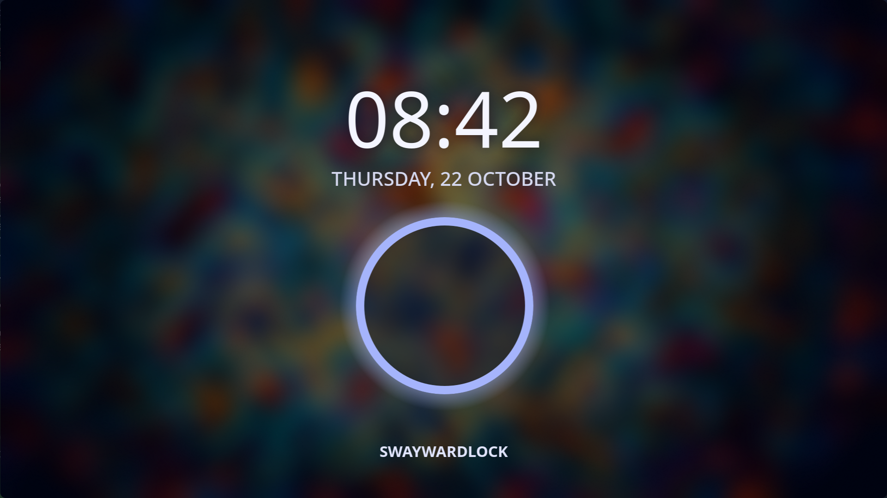
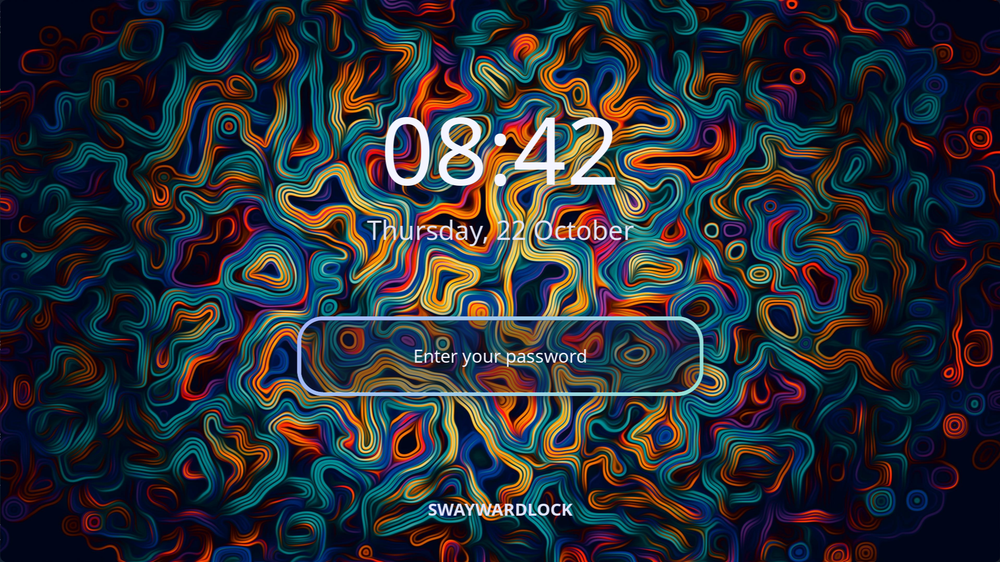

# swaywardlock

**A screen locker for Wayland, built in Rust on Smithay. swaylock's contract, hyprlock's wardrobe.**

> The ring got a glow-up.



A modern lock screen that keeps swaylock's contract. It runs on any compositor with `ext-session-lock-v1` and working EGL/OpenGL ES, and it follows swaylock's `-f`, `--ready-fd` and SIGUSR1 conventions — so it drops into the swayidle line you already have.

It draws blurred screenshots with vibrancy, labels and clocks, an input field, images, shapes, gradients, shadows, rotation, animations, a ring that glows and sweeps, and fingerprint unlock. The widgets follow hyprlock's model. Converters `swaywardlock-swaylock-to-kdl` and `swaywardlock-hyprlock-to-kdl` turn your current config into swaywardlock's and name every option they cannot carry over.

**Status: beta.** Daily-driven on the maintainer's swayward desktop with PAM. Widgets and swaylock-style process conventions are also tested against headless sway on every CI run.

## Why it exists

swaylock is the dependable default: a colour or an image, and a ring. hyprlock showed what a lock screen can look like, with its own config language and its home on Hyprland. Desktop shells ship lock screens as part of the whole desktop.

swaywardlock is for people who pick their pieces one at a time, already have an idle setup built around swaylock, and want a lock screen that looks like this decade without rebuilding that setup. It belongs to the [swayward](https://github.com/swayward-wm/swayward) family and shares its KDL syntax, but it is a standalone locker and does not need swayward.

## A modern stack

Written in Rust, rendered on the GPU with OpenGL ES through [Smithay](https://github.com/Smithay/smithay)'s renderer. Text is laid out by Pango. It talks to the compositor only through the protocols it needs: `ext-session-lock-v1`, fractional scale and viewporter for sharp HiDPI, and `ext-image-copy-capture` or wlr-screencopy for the screenshot behind the blur.

The password lives in a fixed-size buffer that attempts `mlock` and is zeroed when cleared or dropped. PAM runs on its own thread. Fingerprints go through fprintd over D-Bus. The shaders and KDL vocabulary are shared with swayward, so a colour, gradient or animation means the same thing in your compositor config and your lock screen.

## Security: what we tested

Under `ext-session-lock-v1` the compositor keeps the session locked even if the locker crashes. swaywardlock requests unlock only after successful authentication, an explicitly enabled grace period, or SIGUSR1. We test that failures do not request unlock.

- **PAM done carefully.** One transaction starts per initial submit, as in swaylock. Password-then-one-time-code stacks work; `reuse-password` can reuse the previous answer once for an immediately repeated identical prompt. The service file is looked up as libpam looks it up, and swaywardlock refuses to lock if it is missing or unreadable.
- **Real PAM in the test gate.** Tests drive the real libpam with throwaway services (stock modules, faillock, OTP stacks, fingerprint stand-ins). CI runs both the fast and slow gates. [The gates](docs/USING.md#gates) list every check.
- **Hostile conditions.** DPMS off, unplugged outputs, protocol errors, exhausted process limits, huge images and absurd configs are covered by fault-injection and regression tests.
- **Tests that bite.** Unit tests plus shell and pytest suites against headless sway, locally and in CI. Mutation testing found coverage gaps; those are closed. Reviews covered PAM bypass attempts, protocol traces, fuzzing and concurrency.

## Which locker is for you

- **swaylock** — a colour and a ring. Small, mature, widely packaged.
- **hyprlock** — if you are on Hyprland and at home in hyprlang.
- **gtklock** — if you want GTK and its module ecosystem.
- **waylock** — if you want a minimal standalone locker.
- **Noctalia, DankMaterialShell or a Quickshell setup** — if you run that shell and want its integrated lock screen.
- **swaywardlock** — hyprlock's looks with swaylock's process contract, configured in KDL, on any compositor with `ext-session-lock-v1` and working EGL/OpenGL ES.

## Quickstart

Without a config file you get the classic swaylock look. To customize, convert your existing config or start from an example:

```
mkdir -p ~/.config/swaywardlock
swaywardlock-hyprlock-to-kdl ~/.config/hypr/hyprlock.conf > ~/.config/swaywardlock/config.kdl
#   or: swaywardlock-swaylock-to-kdl ~/.config/swaylock/config > ~/.config/swaywardlock/config.kdl
#   or: cp /usr/share/doc/swaywardlock/examples/swayward-ring.kdl ~/.config/swaywardlock/config.kdl
swaywardlock --preview        # see it in a window; edit the file and it redraws
swaywardlock -f               # lock
```

In your idle setup, replace `swaylock` with `swaywardlock`:

```
swayidle -w timeout 300 'swaywardlock -f' before-sleep 'swaywardlock -f'
```

A custom hyprlock-style layout, with oversized widgets and an unblurred wallpaper:



## More

- [Installing, PAM and fingerprints, trying it safely, working on a layout](docs/USING.md)
- `man swaywardlock`: options, signals, exit codes, keys and the config nodes
- [Design and full config reference](docs/specs/2026-10-19-swaywardlock.md)
- [The animated ring style](docs/specs/2026-10-20-ring-style.md)

## Developed with AI assistance

swaywardlock was built largely with AI assistance. A human reviews every change and is responsible for it, following the Linux kernel's rule that [AI does not sign off](https://www.kernel.org/doc/html/next/process/coding-assistants.html). Most of the tokens went into trying to break it.

License: GPL-3.0-or-later.
