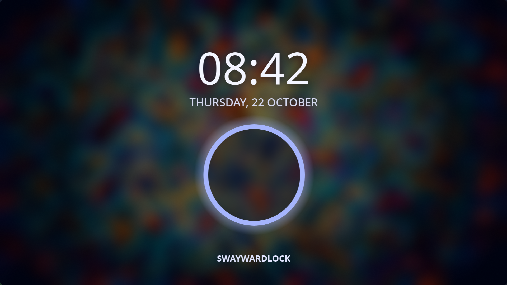
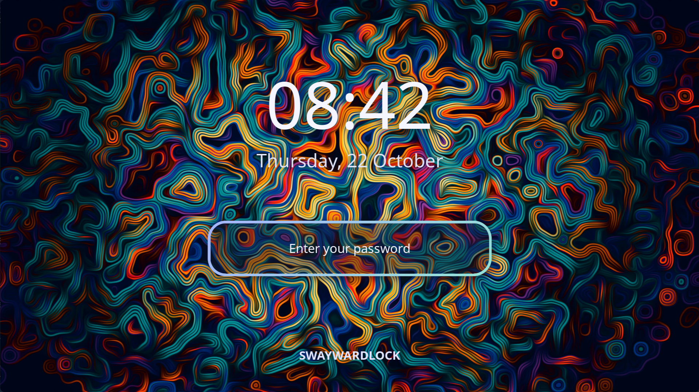

# swaywardlock

**A screen locker for Wayland, built in Rust on Smithay. swaylock's contract, hyprlock's wardrobe.**

> The ring got a glow-up.



swaywardlock is a modern lock screen that keeps swaylock's contract. It runs on any compositor
that offers `ext-session-lock-v1` and has working EGL/OpenGL ES, and it follows swaylock's `-f`,
`--ready-fd` and SIGUSR1 conventions, so it drops into the swayidle line you already have. The
man page lists the exit statuses, including status 3 for post-lock errors.

It draws blurred screenshots with vibrancy, labels and clocks, an input field, images, shapes,
gradients, shadows, rotation, animations, a ring that glows and sweeps, and fingerprint unlock.
The widgets follow hyprlock's model, though not every hyprlock option: click actions
(`onclick`) are out of scope, AVIF images are not supported, and a few options such as
`shadow_boost` and `text_trim` have no equivalent. The converters
`swaywardlock-swaylock-to-kdl` and `swaywardlock-hyprlock-to-kdl` turn your current config into
swaywardlock's and name every option they cannot carry over.

**Status: beta.** swaywardlock runs on the maintainer's swayward desktop with the ring glow-up
layout and PAM authentication. The widgets and the swaylock-style process conventions are also
tested against headless sway on every CI run.

## Why it exists

swaylock is the dependable default: a colour or an image, and a ring. hyprlock showed what a
lock screen can look like, with its own config language and its home on Hyprland. The shells
(Noctalia, DankMaterialShell, the Quickshell setups) ship lock screens as part of the whole
desktop.

swaywardlock is for people who pick their pieces one at a time, already have an idle setup built
around swaylock, and want a lock screen that looks like this decade without rebuilding that
setup. It belongs to the [swayward](https://github.com/swayward-wm/swayward) family and shares
its KDL syntax for colours, gradients, blur, shadows and animations, but it is a standalone
locker and does not need swayward.

## A modern stack

swaywardlock is written in Rust and renders on the GPU with OpenGL ES through
[Smithay](https://github.com/Smithay/smithay)'s renderer, the same one under swayward and niri.
Text is laid out by Pango, so fonts and font descriptions work the way they do in the rest of
your desktop. It talks to the compositor through the Wayland protocols it needs and nothing
more: `ext-session-lock-v1` to lock, fractional scale and viewporter for sharp HiDPI, and
`ext-image-copy-capture` or wlr-screencopy for the screenshot behind the blur.

The password lives in a fixed-size buffer that attempts `mlock` and is zeroed when cleared or
dropped. Failure to lock memory warns but does not stop locking. PAM response copies are outside
this protection, and abort or fatal signals do not run the buffer's destructor. PAM runs on its
own thread so a slow PAM stack does not block the UI thread. Fingerprints go through fprintd over
D-Bus, and only messages from the real fprintd are trusted. The shaders and the KDL vocabulary
are shared with swayward, so a colour, gradient or animation means the same thing in your
compositor config and your lock screen.

## Security: what we tested

A lock screen has one job. Under `ext-session-lock-v1` the compositor keeps the session locked
even if the locker crashes. The compositor holds the lock; swaywardlock requests unlock after
successful authentication, an explicitly enabled grace period, or SIGUSR1. We test that failures
do not request unlock. We also test input and unlock under output changes, resource failures
and slow workers. A crash can still leave a locked session requiring recovery.

- **PAM done carefully.** One transaction starts per initial submit, as in swaylock. Follow-up
  questions normally require another answer, so password-then-one-time-code stacks work;
  `reuse-password` can reuse the previous answer once for an immediately repeated, identical
  prompt; further questions require another answer. The account
  phase is not run, but `pam_nologin` in the auth stack is still enforced. The service file is
  looked up as libpam looks it up, and swaywardlock refuses to lock if it is missing or unreadable.
- **Real PAM in the test gate.** The tests drive the real libpam with throwaway services: stock
  modules, faillock lockouts, one-time-code stacks, fingerprint stand-ins and `pam_permit` stacks
  that must still need an Enter. The slow gate checks the installed service with real PAM when
  root or passwordless sudo is available and reports a skip otherwise; the fast gate leaves that
  privileged check out. CI runs both gates. The end-to-end suite uses a test-auth build, so real
  PAM coverage comes from these checks. An optional check against a real user's password runs on
  request.
- **Hostile conditions.** Monitors turned off (DPMS) or unplugged while locked, the compositor
  sending protocol errors, broken log pipes, exhausted process limits, slow or noisy `cmd[]`
  labels, huge images and absurd config values are covered by fault-injection and regression
  tests.
- **Tests that bite.** Rust unit tests and shell and pytest suites against a real headless sway
  run locally and in CI. Mutation testing found coverage gaps, and the tests now catch the
  medium-severity mutants that survived round two. A mutation round over the most recent
  additions is next. [The gates](docs/USING.md#gates) list every check and what a pass covers.
- **Audited in rounds.** Repeated AI-assisted reviews and fault-injection runs found bugs, each
  fixed and covered by a regression test. Reviews covered PAM bypass attempts, protocol traces,
  fuzzing, concurrency and claims in the docs.

## Which locker is for you

- **swaylock**, if a colour and a ring are all you want. It is small, mature and widely
  packaged. swaywardlock has a swaylock-style default too, but it is a larger program and needs
  working EGL/OpenGL ES.
- **hyprlock**, if you are on Hyprland and at home in hyprlang. swaywardlock follows its widget
  model closely; its converter helps migrate to KDL and reports what it cannot carry over.
- **gtklock**, if you want GTK and its module ecosystem (media controls, a power bar, user info).
- **waylock**, if you want a minimal standalone locker.
- **Noctalia, DankMaterialShell or a Quickshell setup**, if you run that shell: its lock screen
  is themed and integrated with everything else.
- **swaywardlock**, if you want hyprlock's looks with swaylock's process contract, configured in
  KDL, on a compositor with `ext-session-lock-v1` and working EGL/OpenGL ES.

## Quickstart

Without a config file you get the classic swaylock look. To customize it, convert your existing
config or start from an example:

```
mkdir -p ~/.config/swaywardlock
swaywardlock-hyprlock-to-kdl ~/.config/hypr/hyprlock.conf > ~/.config/swaywardlock/config.kdl
#   or: swaywardlock-swaylock-to-kdl ~/.config/swaylock/config > ~/.config/swaywardlock/config.kdl
#   or: cp /usr/share/doc/swaywardlock/examples/swayward-ring.kdl ~/.config/swaywardlock/config.kdl
swaywardlock --preview        # see it in a window; edit the file and it redraws
swaywardlock -f               # lock
```

In your idle setup, replace `swaylock` with `swaywardlock`:

```
swayidle -w timeout 300 'swaywardlock -f' before-sleep 'swaywardlock -f'
```

A custom hyprlock-style layout, with oversized widgets and an unblurred wallpaper:



## More

- [Installing, PAM and fingerprints, trying it safely, working on a layout](docs/USING.md)
- `man swaywardlock`: options, signals, exit codes, keys and the config nodes
- [Design and full config reference](docs/specs/2026-10-19-swaywardlock.md)
- [The animated ring style](docs/specs/2026-10-20-ring-style.md)

## Developed with AI assistance

swaywardlock was built largely with AI assistance. A human reviews every change and is
responsible for it, following the Linux kernel's rule that
[AI does not sign off](https://www.kernel.org/doc/html/next/process/coding-assistants.html). Most
of the tokens went into trying to break it.

License: GPL-3.0-or-later.
